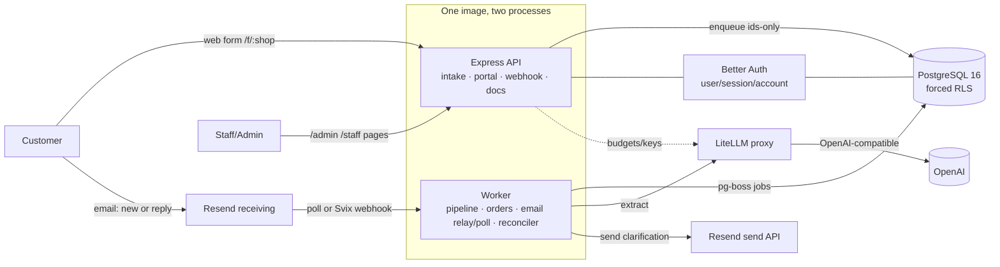

# Riverbend — Architecture Note (2 pages)

Multi-tenant work-order intake for 3 bike shops. A customer message (web form or email) becomes a
catalog-priced work order, or one clarifying question, or a human-review flag — decided by **code**, with
the LLM only proposing structure. **Stack (actual):** TypeScript/Node 22, Express 5, PostgreSQL 16 (forced
RLS), **pg-boss** (Postgres-backed queue — no Redis), Better Auth (human login), Resend (email), a LiteLLM
proxy in front of OpenAI. Two processes from one image: **api** and **worker**. No Next.js, no Redis, no BullMQ.

## A. Components & flow

Only components present in the repo are shown. **pg-boss** uses Postgres as the job store (no broker).
Inbound email is **polling by default** (Resend Receiving API; no public URL) with an optional Svix webhook.
A **new** email becomes a new request, routed to a shop by its **verified destination address**
(`shops.inbound_address`, never the sender); a **reply** (a signed `reply+<token>` address) resumes the
existing request. Both are deduped by provider Message-ID and flow the same durable intake path.

## B. Module boundaries (who owns what)

| Concern | Owner |
|---|---|
| Human authentication / sessions | Better Auth (`src/platform/auth`) — password hashing, cookies, CSRF |
| Shops & tenancy | `src/modules/shops` + `shop_membership` (`src/modules/portal`) |
| Shop API keys (programmatic `/v1`) | `src/modules/auth` (009 credentials) |
| Customer intake (web/email/api) | `src/modules/intake`, `src/api/web-routes`, `src/api/resend-webhook` |
| Catalogue & pricing / estimates | `src/modules/catalog` + `src/modules/orders` (prices in **code**, never the model) |
| LLM extraction + decision | `src/platform/llm` (gateway/prompt/schema) + `src/modules/pipeline` (`decide`) |
| Email in/out | `src/modules/email` (outbox, polling, Svix verify, correlation) |
| Background jobs | `src/platform/queue` (pg-boss) + `src/worker` |
| Budget enforcement | LiteLLM-native team budgets + per-shop virtual keys (`src/modules/budget`) |

## C. Data model (core entities)

`shops` → `messages` (one inbound) → `requests` (state machine) → `extractions` (model output, validated) →
`work_orders` → `work_order_items` (priced from `catalog_service`). `follow_ups` (≤1 per request, the one
clarification). Tenancy: `shop_membership` (Better-Auth user → shop + role) and Feature-009 API-key
credentials. Idempotency: `messages UNIQUE(shop_id, source, submission_id)`. Email: `email_outbox`
(one/request), `inbound_emails` (Message-ID dedup), `email_events` + `email_poll_state` (provider ingestion);
`shops.inbound_address` maps a verified receiving address → shop for new-email routing.
Budget/accounting: `shop_budgets`, `llm_calls`. Better Auth: `user/session/account/verification` (global).
`auth_bootstrap` (single-use first-admin marker). Every shop-owned table has a `shop_id` and **forced RLS**.

## D. Tenant isolation (defence in depth)

1. **Identity:** `/v1` authenticates by a hashed shop API key → the shop id; the portal authenticates by a
   Better-Auth session → `shop_membership` → the shop id. A client-supplied `shop_id` is never trusted, and an
   inbound email's tenant is its **verified destination address**, never the (spoofable) sender.
2. **Forced RLS:** every shop-owned table has `FORCE ROW LEVEL SECURITY` + a tenant policy; the runtime role
   `app_user` is `NOBYPASSRLS`. Each request runs inside `set_config('app.tenant_id', <shop>)` via
   `withTenant`, so even a bug cannot read another shop's rows. A readiness policy-check asserts any table
   with `shop_id` has forced RLS + a policy.
3. **Cross-shop paths are explicit:** identity/provisioning use the `app_admin` role (documented D2
   exception); the queue carries **ids only** and the worker re-establishes tenant context per job.
4. **Constraints:** FKs are composite `(id, shop_id)` where it matters; `UNIQUE(shop_id, …)` for dedup.
5. **LLM identity:** each shop gets its own LiteLLM team + virtual key; spend is attributed per shop.
6. **Remaining risk:** Better Auth's own tables are global (not RLS) by design (no `shop_id`); authorization
   is enforced by `shop_membership`. Background jobs trust the enqueued `shop_id` (written only by our code).

## E. Three decisions worth challenging

| Decision | Alternative | Why chosen | Accepted limitation |
|---|---|---|---|
| **LiteLLM-native budgets** (per-shop team + virtual key) instead of a custom Postgres spending ledger | A reserve-then-settle ledger in Postgres (we built one, kept as fallback) | One enforcement point owned by the proxy; no second competing engine; real provider cost | Enforcement is a **bounded soft cap** (~one in-flight call overshoot), not a hard transactional reservation (constitution 2.0.0) |
| **Explicit idempotency keys** (`submission_id` UUID) instead of content-only duplicate detection | Hashing the message body to detect dupes | A genuine resend/retry is one operation; two identical descriptions are two real requests; survives edits | The client must mint a fresh id per operation (D24 fixed a bug where it was reused) |
| **Human review for cancellations** (D23) instead of automatic cancellation | Auto-cancel the matching order | Ownership can't be proven from email/wording; no OTP/verified-channel flow in scope → fail safe | A staff member must act; no self-service cancel (verified-channel cancellation is deferred) |

Detailed decisions: `docs/ARCHITECTURE_DECISIONS.md` (D1–D24). Deployment: `docs/gcp-deployment.md`. Omissions
& scaling: `docs/not-built.md`. Evaluation: `docs/evaluation-results.md`.
